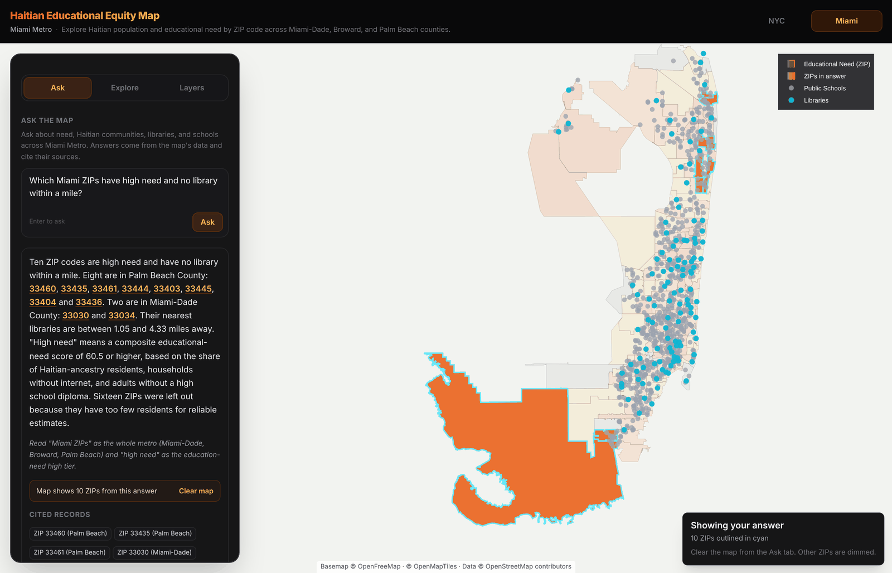

# Haitian Educational Equity Map


An interactive map for exploring Haitian population density, educational need, and nearby resources across U.S. metros, with an "ask the map" box that answers plain-English questions from the data. Built with Next.js, Plotly and the Claude API.

## Ask the map

Type a question; get a short answer, the matching ZIPs highlighted on the map, and the sources behind every figure.



- **How it works:** Claude Haiku 5.5 chooses a query tool; tested code computes every figure; the server checks each ZIP and citation in the answer against what the tools returned.
- **Does it work:** 120 of 120 correct on a 40-question golden set run three times, and 36 of 36 on held-out rewordings. About $0.001 and 4 seconds per question.
- **What that score missed:** a new kind of question tried after the final run was wrong 2 times in 5. It is fixed and written up, along with seven other things that broke.

Read the [deployment brief](docs/WRITEUP.md) (framed for a literacy nonprofit), the [five-minute demo script](docs/DEMO.md), and the [evaluation history](eval/HISTORY.md).

## The map

The app overlays ZIP-level demographic choropleths with public schools and library locations to help identify corridors where high Haitian population overlaps with limited internet access, low educational attainment, and gaps in tutoring support.

## Overview

This project is a config-driven equity mapping tool for Haitian communities. It uses the same Census variables and need-scoring methodology across metros, while swapping boundary sources, region filters, and overlay datasets per city.

Currently supported metros:

| Metro | Route | Regions | ZIP areas |
|-------|-------|---------|-----------|
| **New York City** | `/map/nyc` | 5 boroughs | 177 MODZCTAs |
| **Miami Metro** | `/map/miami` | Miami-Dade, Broward, Palm Beach | 181 ZCTAs |

Visit `/` to pick a metro, or use the header switcher to move between maps. Layer preferences (need mode, toggles, opacity) carry over; ZIP and region selection reset on switch.

## Features

- **Ask the map**: natural-language questions answered from the data, with citations and a highlighted map
- **Multi-metro support** — NYC and Miami Metro with shareable routes (`/map/nyc`, `/map/miami`)
- **Haitian Pop Heat (ZIP)** — Choropleth using Census ACS 2022 data
- **Need scoring modes**
  - **Population %** — Haitian ancestry as a share of total population
  - **Educational Need** — Composite score (40% Haitian pop · 30% no internet · 30% no HS diploma)
- **High / Medium / Low Need** tiers with a color legend and per-ZIP detail panel
- **Public schools** — NYC schools color-coded by graduation rate; Miami metro shows school locations across three counties
- **Libraries** — Public library locations (possible tutoring and literacy sites)
- **Layer toggles**, opacity control, region filter (borough/county), and ZIP search
- **Click-to-select** — Click a ZIP on the map to inspect neighborhood stats; map flies to the selection

## Data Sources

### Shared

| Source | Used for |
|--------|----------|
| [U.S. Census ACS 2022 (5-year)](https://api.census.gov/data/2022/acs/acs5) | Haitian ancestry, population, language, internet, education by ZCTA and county |

### New York City

| Source | Used for |
|--------|----------|
| [NYC MODZCTA boundaries](https://data.cityofnewyork.us/Health/Modified-Zip-Code-Tabulation-Areas-MODZCTA-/pri4-ifjk) | ZIP polygon geometry |
| [NYC Open Data — High Schools](https://data.cityofnewyork.us/Education/2018-2019-School-Level-Detailed-Report-Card/vw9i-7mzq) | School locations and performance metrics |
| [NYC Open Data — Libraries](https://data.cityofnewyork.us/City-Government/Public-Library-Locations/feuq-due4) | Library locations |

### Miami Metro

| Source | Used for |
|--------|----------|
| [Census TIGER ZCTA boundaries](https://tigerweb.geo.census.gov/arcgis/rest/services/TIGERweb/PUMA_TAD_TAZ_UGA_ZCTA/MapServer/11) | ZIP polygon geometry (filtered via `data/miami-msa-zctas.json`) |
| [Census 2020 ZCTA-to-county relationship file](https://www2.census.gov/geo/docs/maps-data/data/rel2020/zcta520/tab20_zcta520_county20_natl.txt) | Which ZIPs belong to each county (`npm run zctas:miami`) |
| [Miami-Dade GIS — MD_Emaps](https://gisweb.miamidade.gov/arcgis/rest/services/MD_Emaps/MapServer) | Public schools and libraries |
| [Broward GeoHub](https://geohub-bcgis.opendata.arcgis.com) | Public schools |
| [Broward County GIS — Libraries](https://bcgishub.broward.org/server/rest/services/Core/Libraries/MapServer/0) | Library branches |
| [Palm Beach County GIS — Education Open Data](https://maps.co.palm-beach.fl.us/arcgis/rest/services/OpenData/Education_Open_Data/MapServer) | Public schools and libraries |

> **Note:** ZIP boundaries approximate USPS mail routes. NYC uses Modified ZCTA (MODZCTA); Miami uses standard Census ZCTA. ACS estimates have margins of error; ZIPs with small populations may show as "Insufficient Data."

## Getting Started

### Prerequisites

- Node.js 20+
- A free [Census API key](https://api.census.gov/data/key_signup.html)
- A [Claude API key](https://platform.claude.com) for ask-the-map (the map works without it)

### Install and run

```bash
npm install
cp .env.example .env.local
```

Add your keys to `.env.local` (never commit this file):

```env
CENSUS_API_KEY=your_key_here
ANTHROPIC_API_KEY=your_key_here
```

```bash
npm run dev
```

### Open the app

| URL | Description |
|-----|-------------|
| `http://localhost:3000` | Metro picker landing page |
| `http://localhost:3000/map/nyc` | New York City map |
| `http://localhost:3000/map/miami` | Miami Metro map |

The first load of the ZCTA layer may take 20–30 seconds while Census data is fetched; results are cached server-side for one hour.

### Optional environment variables

| Variable | Required | Description |
|----------|----------|-------------|
| `CENSUS_API_KEY` | Recommended | Census Bureau Data API key. Without it, requests go keyless at a low rate limit. |
| `ANTHROPIC_API_KEY` | For ask-the-map | Claude API key |
| `NEXT_PUBLIC_BASEMAP_STYLE_URL` | No | MapLibre style URL for the background map (default: OpenFreeMap positron) |
| `NEXT_PUBLIC_NYC_SODA_APP_TOKEN` | No | NYC Open Data app token for higher rate limits (NYC only) |

## Scripts

| Command | Description |
|---------|-------------|
| `npm run dev` | Start development server (webpack) |
| `npm run dev:turbo` | Start development server (Turbopack) |
| `npm run build` | Production build |
| `npm run start` | Start production server |
| `npm run lint` | Run ESLint |
| `npm test` | Run unit tests (Vitest) |
| `npm run typecheck` | Type-check with `tsc` |
| `npm run verify` | Type check, tests, basemap check and build in one command (run before deploying) |
| `npm run zctas:miami` | Rebuild the Miami ZIP list from the Census ZCTA-to-county file |
| `npm run ask -- "question"` | Ask the map from the command line (needs `ANTHROPIC_API_KEY`) |
| `npm run eval` | Run the golden set through the agent and report accuracy |
| `npm run check:basemap` | Verify the basemap style and tiles load without a key (run before deploying) |
| `npm run truth` | Recompute golden-set answers independently in Python |
| `npm run snapshot` | Freeze live public data into `data/snapshots/` (both metros; or `npm run snapshot -- miami`) |

## Data snapshots

The map itself loads live data. The ask-the-map agent and its golden-set eval instead read a frozen copy in `data/snapshots/<metro>/`, so answers and accuracy numbers are reproducible and every number can be cited.

Each snapshot has four files:

| File | Contents |
|------|----------|
| `manifest.json` | Creation time, cited sources with URLs, record counts, need-tier breakpoints, methodology, data-quality warnings |
| `zips.geojson` | One feature per ZIP: Census figures, need score and tiers, `reliable` flag, `id` like `zip:33127` |
| `libraries.json` | Library points with `id` like `lib:miami:3f2a9c1d`, source ID, and the ZIP the point actually falls in |
| `schools.json` | School points, same shape, plus school attributes (grades, graduation rate in NYC) |

ZIP boundaries are simplified to ~5 m and coordinates rounded to 5 decimals (~1 m), which is negligible for mile-scale questions. A place's `zip` comes from point-in-polygon against the ZIP boundaries; the source dataset's own value is kept as `reportedZip`, since some sources (Broward libraries) have none.

Re-run `npm run snapshot` to refresh. A failed run leaves the existing snapshot untouched, and `npm test` checks committed snapshots for consistency.

## Query engine (ask-the-map tools)

`lib/query/` answers structured questions over a snapshot with deterministic code; the LLM only chooses which tool to call and how to phrase the answer.

| Tool | Answers |
|------|---------|
| `find_zips` | "Which ZIPs…" / "top N ZIPs…": filter by need tier, Census metrics, county/borough, and distance to libraries or schools |
| `get_zip` | One ZIP's profile, need rank, nearest libraries and schools |
| `find_places` | Libraries or schools by area, name, or distance from a ZIP |
| `summarize_regions` | County/borough totals and comparisons |
| `describe_data` | Definitions, sources, and what the data does not cover |

Every result carries the record IDs it used (for citations), their source IDs, the assumptions an answer must disclose (for example how "high need" and "within a mile" are defined), and a map view (ZIPs to highlight, layers to show).

Distances are straight-line miles on a local plane scaled to the WGS84 ellipsoid. By default they are measured from a ZIP's nearest edge, so a library inside the ZIP is 0 miles; `measure: "center"` measures from a point inside the ZIP instead. Kiosks and the county law library are listed but do not count as library access.

## Basemap

The background map is OpenFreeMap's "positron" style: free, no API key, no registration (https://openfreemap.org). Its attribution is shown at the bottom of the map and must stay visible.

The map previously used Plotly's built-in `carto-positron` style. Since 25 September 2026 CARTO serves raster tiles only with an API key, and shows an "API KEY REQUIRED · carto.com/basemaps/apikey" watermark otherwise. The map now uses Plotly's MapLibre traces (`choroplethmap`, `scattermap`, `layout.map`), which also replace the Mapbox traces Plotly removes in v4.

To use a different provider, set `NEXT_PUBLIC_BASEMAP_STYLE_URL` to any MapLibre style JSON URL (and `NEXT_PUBLIC_BASEMAP_ATTRIBUTION` to its credit line), e.g. CARTO with a free key (non-commercial use is free up to 5M tiles a month). Before deploying, run:

```bash
npm run check:basemap   # fails if the style or a real tile over Miami/NYC doesn't load, or a CARTO URL has no key
```

## Ask the map (agent)

`POST /api/ask` with `{ "question": "...", "metro": "miami" | "nyc", "model"?: "claude-haiku-5-5" | "claude-sonnet-5-5" }` answers a natural-language question. Claude chooses which query tools to call; the tools compute every figure; Claude writes the answer and ends by calling a strict `submit_answer` tool. Before returning, the server:

- drops any citation that no tool returned, and flags ZIP codes in the answer that no tool returned (`warnings`);
- attaches the assumptions from the tools that ran (definitions of need and distance, excluded ZIPs), so required disclosures can't be omitted;
- sends the answer back once for a rewrite if it names a ZIP no tool returned, corrects itself mid-answer, or shows an internal field name;
- picks the map view (ZIPs to highlight, layers) from the tool results the answer cites, and shows no map for out-of-scope answers;
- reports the tool trace, token usage, and estimated cost.

Needs `ANTHROPIC_API_KEY` in `.env.local`. Default model is Claude Haiku 5.5. The route allows 20 questions per minute per IP.

```bash
npm run ask -- "Which Miami ZIPs have high need and no library within a mile?"
npm run ask -- --metro nyc --model claude-sonnet-5-5 "Top 3 Brooklyn ZIPs by Haitian ancestry"
npm run eval -- --runs 3 --report                 # 40 golden questions x 3 → eval/REPORT.md
npm run eval -- --set holdout --runs 3 --report   # 12 held-out rewordings → eval/REPORT-holdout.md
npm run eval -- --only G07,G14                    # a subset
```

## Evaluation

Latest (Claude Haiku 5.5, 13 Nov 2026 data, run 16 Nov 2026): **120/120 golden answers correct (40 questions × 3 runs) and 36/36 held-out rewordings**, 100% grounded, about $0.001 and 4 s per question. See `eval/REPORT.md`, `eval/REPORT-holdout.md`, and `eval/HISTORY.md` for how it got there and what the score does not show.

The score covers questions like the ones in the set. A three-county comparison that was not in the set was wrong 2 times in 5 while the set scored 100% (run 12 in the history); expect real users to find more.

Each answer is scored on: right data retrieved (the agent's tool calls are re-run and compared with the answer key), the written answer stating the result (figures, ZIPs in order, place, count, or a correct refusal), and grounding (no ZIPs or citations no tool returned). The report also tests the scorer by corrupting real answers and checking it catches them.

## Golden set

`eval/golden.json` holds the evaluation questions with a reference interpretation and tool call. `npm run truth` (Python; `pip install -r eval/requirements.txt`) recomputes every expected answer in `eval/golden.expected.json` with an independent implementation (Shapely + pyproj geodesic distances, need scores recomputed from raw ACS fields), and `npm test` checks the TypeScript engine agrees. Re-run `npm run truth` after every `npm run snapshot`.

## Project Structure

```
app/
  page.tsx                    # Metro picker landing page
  map/[metroId]/page.tsx      # Dynamic metro map routes
  api/
    demographics/             # County/borough-level Census ACS data
    ask/                      # Ask-the-map agent endpoint
    haitian-zcta/             # ZIP choropleth (Census + boundaries join)
    schools/                  # School point GeoJSON
    libraries/                # Library point GeoJSON
components/
  CommuteApp.tsx              # Data fetching and state orchestration
  AppShell.tsx                # Header with metro switcher
  MetroSwitcher.tsx           # NYC / Miami toggle
  MetroLanding.tsx            # Landing page metro cards
  NYCMapCore.tsx              # Plotly map rendering
  Sidebar.tsx                 # Ask tab, layer controls, legend, ZIP panel
  AskPanel.tsx                # Question box, answer, sources, "How this was answered"
  HeatLegend.tsx              # Choropleth color scale legend
  ZctaInfoPanel.tsx           # Selected ZIP detail panel
data/
  miami-msa-zctas.json        # Miami ZIP list with county assignment (generated)
  snapshots/                  # Frozen data the agent and eval read
docs/
  WRITEUP.md                  # Deployment brief
  DEMO.md                     # Five-minute demo script
lib/
  metroRegistry.ts            # Metro configs (regions, labels, overlays)
  metroApi.ts                   # Metro query param helpers
  boundaries.ts                 # MODZCTA and TIGER boundary fetchers
  enrichHaitianZcta.ts          # Shared need-tier enrichment
  demographics.ts               # County demographics parser
  miamiOverlays.ts              # Miami-Dade, Broward, Palm Beach overlays
  haitianNeed.ts                # Need tier classification and composite scoring
  census.ts                     # Census API helpers
  geo.ts                        # GeoJSON utilities
  haitianZctaBuild.ts           # Boundary + Census join (shared by API route and snapshot)
  nycOverlays.ts                # NYC libraries and schools fetchers
  snapshot/                     # Frozen-data format, builder, loader, cited sources
  query/                        # Ask-the-map tools: engine, distances, tool schemas
  agent/                        # Claude tool loop, system prompt, answer checks, pricing
  eval/                         # Golden-set loading and scoring
eval/
  golden.json                   # 40 golden questions
  holdout.json                  # 12 held-out rewordings
  ground_truth.py               # Independent expected answers (`npm run truth`)
  REPORT.md, REPORT-holdout.md  # Latest results
  HISTORY.md                    # Every evaluation run and what it changed
scripts/
  snapshot.ts                   # `npm run snapshot`
tests/                          # Vitest unit tests and fixtures
```

## API Routes

All routes accept an optional `?metro=nyc|miami` query parameter (defaults to `nyc`). Responses follow `{ success: true, data: ... }` or `{ success: false, error: "..." }`.

| Route | NYC | Miami |
|-------|-----|-------|
| `GET /api/haitian-zcta` | MODZCTA GeoJSON + Census join, need tiers | TIGER ZCTA GeoJSON + Census join (181 ZIPs), need tiers |
| `GET /api/demographics` | 5 borough county-level metrics | 3 county-level metrics (Miami-Dade, Broward, Palm Beach) |
| `GET /api/schools` | NYC Open Data with graduation rates | Miami-Dade, Broward, and Palm Beach GIS locations |
| `GET /api/libraries` | NYC Open Data locations | Miami-Dade, Broward, and Palm Beach GIS locations |

## Example Findings

Figures are ACS 2022 5-year estimates summed over the ZIPs in each county or borough (13 Nov 2026 snapshot). A test (`tests/metroCopy.test.ts`) ties the landing-page headline to these totals.

### Miami Metro (336,114 residents of Haitian ancestry)

| County | Haitian ancestry | Share of residents | High-need ZIPs | Libraries | High-need ZIPs with no library within 1 mile |
|---|---|---|---|---|---|
| Broward | 128,878 | 6.6% | 13 | 44 | 0 |
| Miami-Dade | 114,958 | 4.3% | 23 | 50 | 2 |
| Palm Beach | 92,278 | 6.2% | 19 | 19 | 8 |

- **Broward**, not Miami-Dade, has the most residents of Haitian ancestry and the highest share.
- **Miami-Dade** has the most high-need ZIPs and the ZIPs with the highest Haitian share (33168, 33161, 33162, in the North Miami area).
- **Palm Beach** has the fewest libraries and eight of the ten high-need ZIPs with no library within a mile. This is the clearest gap the data shows.

### New York City (118,568 residents of Haitian ancestry)

| Borough | Haitian ancestry | Share of residents | High-need ZIPs |
|---|---|---|---|
| Brooklyn | 70,920 | 2.7% | 18 |
| Queens | 34,216 | 1.5% | 11 |
| Manhattan | 6,695 | 0.4% | 6 |
| Bronx | 5,549 | 0.4% | 12 |
| Staten Island | 1,188 | 0.2% | 2 |

- **Brooklyn** has about 60% of the city's residents of Haitian ancestry; **Queens** has most of the rest.
- **The Bronx** has few residents of Haitian ancestry but the weakest education indicators: in its median ZIP, 27% of adults have no high school diploma and 13% of households have no internet.
- Every high-need NYC ZIP has a library within a mile, so library distance does not separate neighborhoods there the way it does in South Florida.

"High need" is the top third of ZIPs in each metro on the composite score. Libraries are a stand-in for tutoring sites; the data has no tutoring programs.

## Future Improvements

- Pilot ask-the-map with real staff and add their questions to the golden set
- Follow-up questions (the agent currently answers one question at a time)
- Show ACS margins of error alongside estimates
- Serve the map layer from the same frozen snapshot the agent reads, so the two cannot drift
- A phone layout (the sidebar currently covers the map on small screens)
- Add deep links (`?zip=`, `?mode=`, `?region=`) for shareable map states
- Incorporate school performance data for Miami metro counties
- Add tract- or neighborhood-level demographic resolution
- Incorporate more direct tutoring and after-school program datasets
- Support exportable reports or snapshots for advocacy use
- Add additional metros via `lib/metroRegistry.ts`

## Why This Project Matters

This project is designed as a data-driven equity mapping tool for Haitian communities in major U.S. metros. It can support:

- Community advocacy
- Education-focused nonprofit analysis
- Public-interest research
- Resource allocation discussions
- Cross-metro comparison of immigrant support infrastructure

By combining demographic and educational support data in one interface, the map helps make service gaps easier to identify and communicate.

## License

Private project.
