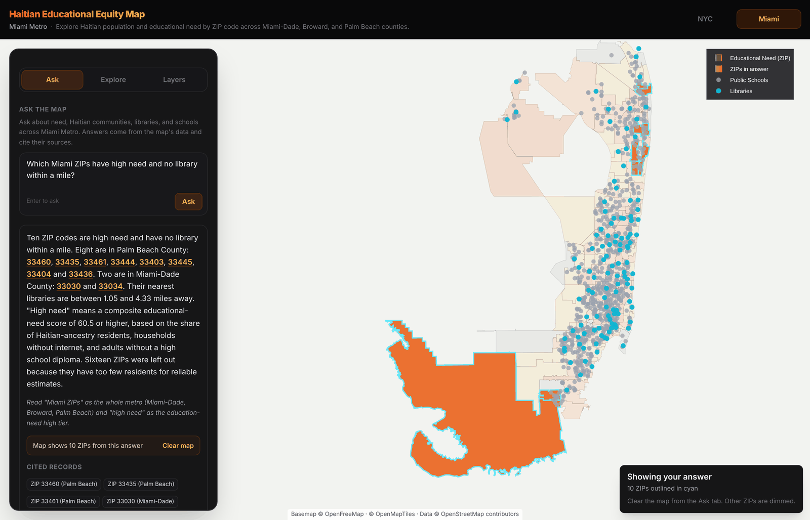
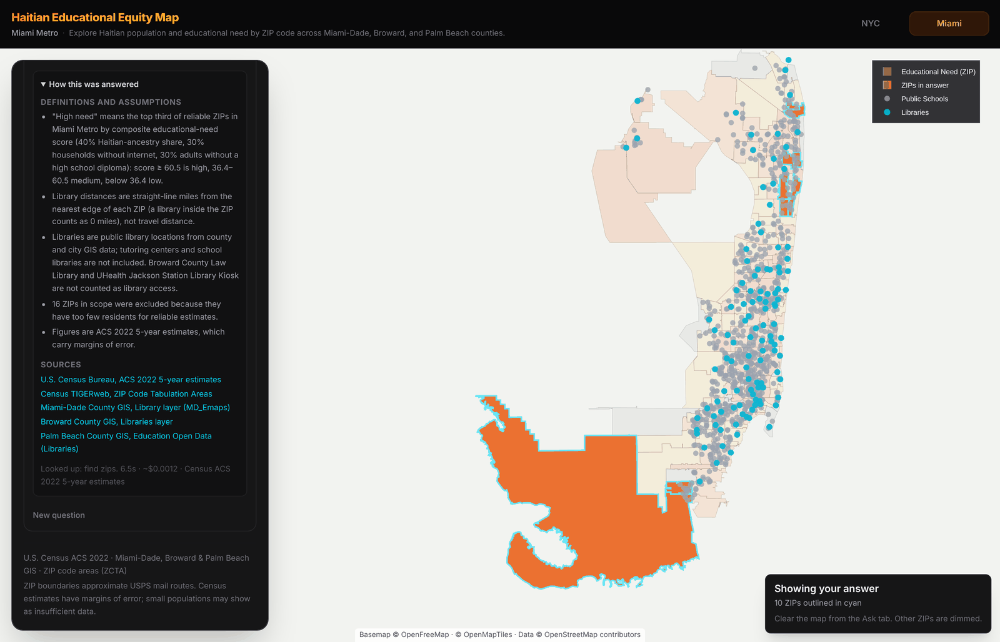

# Ask the Map: a deployment brief

**For:** a literacy nonprofit deciding where to open tutoring and ESL sites for Haitian families in South Florida.
**Status:** working prototype, evaluated offline. Not yet piloted with real staff.

## The decision it supports

A program director has funding for a few new tutoring sites and needs to choose where. The evidence is public but scattered: Census tables for ancestry, language, internet access and education; three county GIS portals for libraries and schools. The Haitian Educational Equity Map already joins these on one map. What it couldn't do was answer a question.

"Ask the map" adds that. A staff member types a question in plain English and gets a short answer, the ZIPs highlighted on the map, and the sources behind every figure.

> **Which Miami ZIPs have high need and no library within a mile?**
> Ten ZIPs. Eight are in Palm Beach County and two in Miami-Dade; none are in Broward. The nearest library is between 1.1 and 4.3 miles away.

That answer is a site-selection lead: Palm Beach has 19 libraries for 92,278 residents of Haitian ancestry, against 50 in Miami-Dade and 44 in Broward, and it holds eight of the ten high-need ZIPs with no library nearby.

## How it works

1. **The data is frozen.** A script snapshots Census ACS 2022 figures, ZIP boundaries, 113 libraries and 849 schools for the Miami metro (and the equivalent for New York City). Every record gets an ID and a source link.
2. **Code does the math.** Five query tools filter and rank ZIPs, measure distances, and total counties. They are ordinary, tested code.
3. **The model chooses and explains.** Claude Haiku 5.5 reads the question, decides which tool to call, and writes the answer from what the tool returned. It never computes a figure itself.
4. **The server checks the answer before showing it.** Citations must point at records a tool returned. A ZIP code no tool returned, a self-correction mid-sentence, or an internal field name sends the answer back for one rewrite; if it persists, the user sees a warning.

Each answer carries the definitions it depends on. "High need" means the top third of ZIPs on a composite of Haitian-ancestry share, households without internet, and adults without a high school diploma. "Within a mile" is measured in a straight line from the ZIP's nearest edge. When the data can't answer a question (graduation rates, tutoring programs, crime), the tool says so and names the closest thing it does have.

## Does it work?

A 40-question golden set covers lookups, rankings, distance questions, multi-condition filters, county comparisons, ambiguous questions and out-of-scope questions. The answer key is computed by a separate Python program that shares no code with the app.

| Measure (Claude Haiku 5.5) | Result |
|---|---|
| Golden set, 40 questions × 3 runs | **120 of 120 correct** |
| Held-out rewordings (casual, misspelled, indirect), 12 × 3 | **36 of 36 correct** |
| Answers with an unverified ZIP or citation | 0 of 156 |
| Typical response time | 3.8 s (95% under 6.4 s) |
| Cost per question | about $0.001 |

"Correct" means two things both hold: the agent retrieved the right data, and the written answer states it (the right figure, every ZIP, rankings in order, or a proper refusal).

The scorer was tested too. Real answers were deliberately corrupted (a changed number, a dropped ZIP, a swapped ranking, the wrong county) and re-scored. It caught 44 of 45 changed numbers and every other corruption.

## What broke, and what that taught us

The score above is the end of twelve evaluation runs. The failures on the way are the more useful result.

| What we found | How | What changed |
|---|---|---|
| The "Broward libraries" feed was nine libraries in Richmond, Virginia. The map had been showing zero Broward libraries. | A sanity test on where points fall | Switched to Broward County's own layer (44 locations); the snapshot now refuses any source that sits outside the metro |
| The Miami ZIP list was hand-typed and missing Florida City, Jupiter and Tequesta | Same test | List is generated from the Census ZIP-to-county file |
| The landing page claimed about 830,000 residents of Haitian ancestry in Miami. The data says 336,114. | Checking figures for this brief | Corrected, and a test now ties the headline to the data |
| "No library within a mile" gives 10 ZIPs measured from a ZIP's edge and 37 from its center | Building the answer key | Edge is the default and every answer states it |
| A first perfect score hid invented geography ("the western ZIPs") and unrequested advice | Reading answers by hand | Prompt rules, plus a report flag |
| The model sometimes corrected itself inside an answer ("Miami-Dade has more… wait, Broward is higher") | The answer-text check | Server sends such answers back for a clean rewrite |
| Asked to compare three counties, the model said Miami-Dade had the most residents of Haitian ancestry (114,958) when Broward has more (128,878), 2 times in 5. The golden set was scoring 120 of 120. | Trying a new question while writing the demo script | The tool now ranks the counties in code and the model is told not to compare numbers itself; 10 of 10 correct afterwards |
| The model wrote part of its answer in the wrong field about 1 time in 10, silently dropping citations | First live run | Server repairs it; every case recovered |
| The basemap provider began requiring an API key and watermarked the map | A user saw it | Moved to a keyless provider; a pre-deploy check fails if tiles don't load |

Four lessons carry over to any deployment like this. Public data needs tests as much as code does. A perfect score should prompt a check of the scorer and a read of the answers. Several "failures" were the scorer's fault, so the evaluation needs its own tests. And a test set written by the builder measures the questions the builder thought of: the first new kind of question found a real error.

## Running it

- **Cost.** About $0.001 per question. A thousand questions a month is about $1 in model usage. The whole build and evaluation used about $1.
- **Hosting.** One Next.js app. It needs one secret, `ANTHROPIC_API_KEY`. The basemap needs no key.
- **Before each deploy.** `npm run verify` runs the tests, type check, basemap check and build.
- **Guardrails already in place.** Questions are capped at 500 characters; each visitor gets 20 questions a minute and 100 a day; all visitors together share a daily budget (default $5, `ASK_DAILY_BUDGET_USD`); visitors can't switch to a pricier model; the app does not store questions.
- **To do before public launch.** Set a monthly spend limit in the Claude Console. On Vercel, add Upstash Redis so the limits are shared across instances (without it they fall back to per-instance memory).
- **Refreshing data.** `npm run snapshot`, then `npm run truth`, then `npm run eval -- --runs 3 --report`. If the score moves, the report says where.

## Limits

- **No real users yet.** I wrote the questions and tuned the prompt on them. The held-out rewordings test phrasing, not new kinds of question, and the one new kind tried so far exposed an error (see the table above). Expect more in a pilot.
- **One question at a time.** It has no memory of the previous answer.
- **Estimates, not counts.** ACS figures are survey estimates with margins of error, and the tool doesn't show them. ZIPs with very small populations (under 500 residents, or under 10 of Haitian ancestry) are excluded.
- **Straight-line distance.** A mile on the map is not a mile by bus.
- **Libraries are a proxy.** The data has no tutoring programs, and Miami school data has no performance measures.
- **The speaker count is broad.** The Census groups French, Haitian Creole and Cajun speakers together.
- **Miami first.** New York City works but has 7 of the 40 test questions.

## What a pilot should do

Give five staff members the tool for two weeks and log every question. Add those questions to the golden set with answers a staff member confirms. Track the same measures on each change. The first thing to learn is which questions people ask that the data can't answer; that is the list of datasets worth adding next, starting with tutoring and after-school programs.

---

Details: [`eval/REPORT.md`](../eval/REPORT.md) (final results), [`eval/REPORT-holdout.md`](../eval/REPORT-holdout.md) (rewordings), [`eval/HISTORY.md`](../eval/HISTORY.md) (all twelve runs), [`docs/DEMO.md`](DEMO.md) (a five-minute walkthrough).
